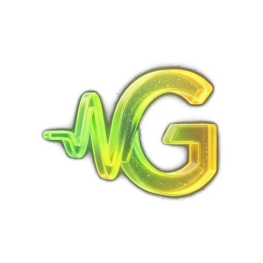
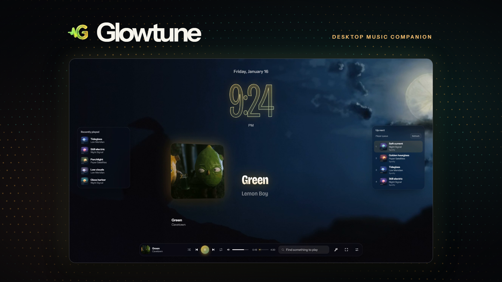
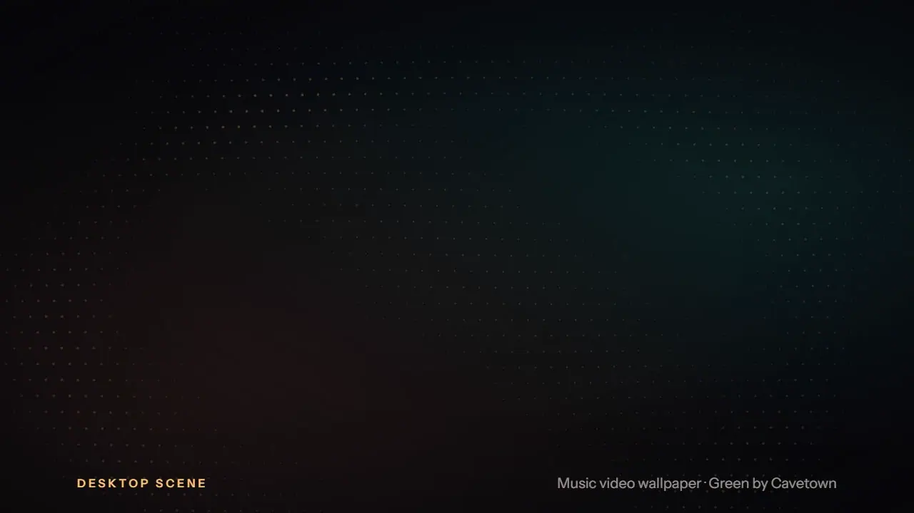
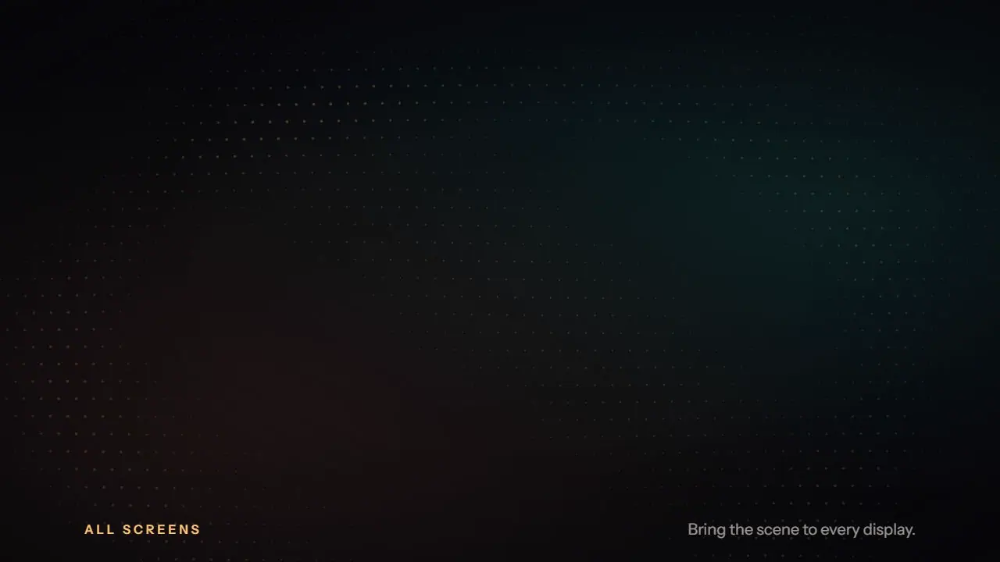
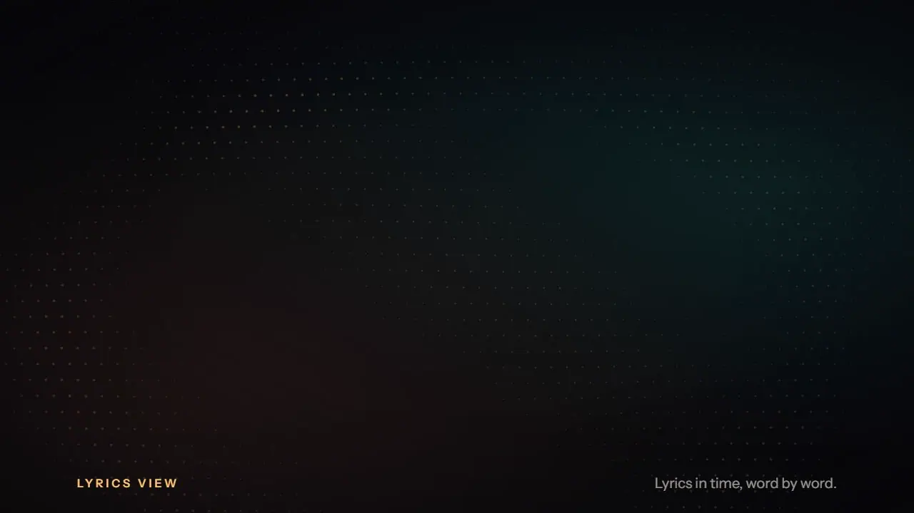
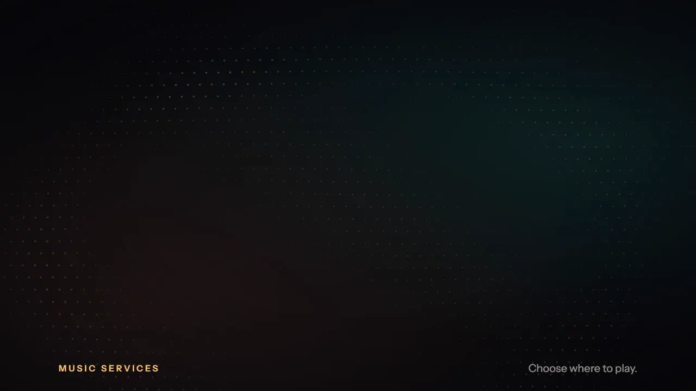
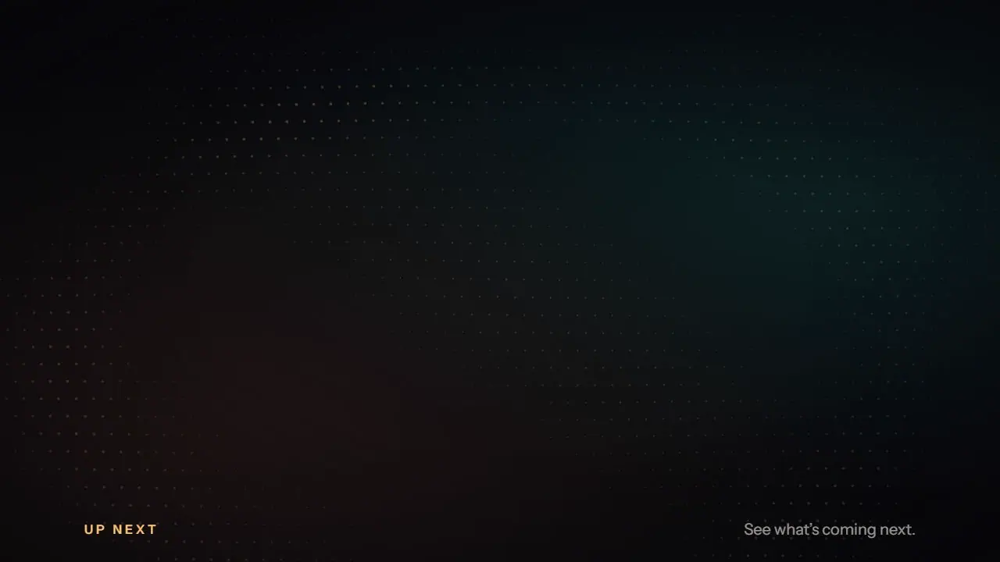
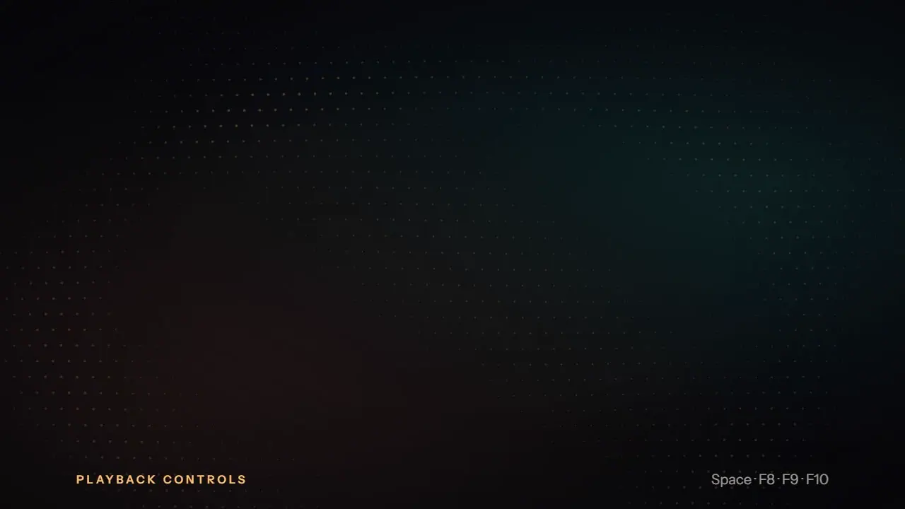
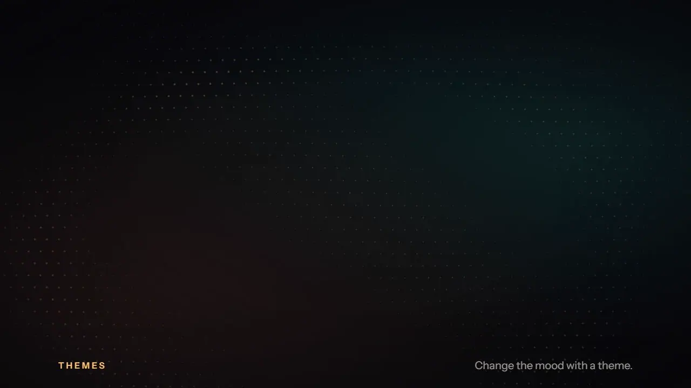

<div align="center">



# Glowtune

**Your music, all over your screen.**
Glowtune follows whatever you play, lights your screen edges in the album's colors,
shows synced lyrics, and turns your desktop into a live music scene.

<a href="../../releases/latest"></a>

<sub>Watch the 70-second video: <a href="../../releases/latest">glowtune-hero.mp4</a> on the latest release.</sub>

[**Download for Windows**](../../releases/latest) · [Features](#features) · [Privacy](PRIVACY.md) · [Build from source](#build-from-source)

</div>

---

## Features

### Edge glow
Your screen edges light up in the colors of the album that's playing and pulse with the beat. The glow switches off by itself when a game or video goes full screen; you can choose to keep it on. Pick which screens glow.


### Desktop scene
A live wallpaper behind your windows: a big clock, the album art, synced lyrics, recently played songs and what's up next, over the album's colors or the song's music video. Press **F11** for full screen, **Esc** to leave. Turn on **All screens** to fill every monitor.





### Synced lyrics
Lyrics scroll in time with the song, word by word. Choose from five styles (flow, bold, karaoke, outline, sticker). The **Lyrics view** gives them the whole screen: put them on the left, in the middle or on the right, and make them compact, normal or large. Lyrics also float on your desktop in their own small window.



### Make the layout yours
Open **Edit layout** and drag any block where you want it. Pull an edge or corner to resize it: wide, tall or small, the clock, art, lyrics and lists adapt to the space they get. The Lyrics view keeps its own layout.


### Your music services, inside Glowtune
Spotify, Apple Music, YouTube Music and SoundCloud play in their own Glowtune windows. Sign in once and you stay signed in. Ads are blocked in these windows.



### Search and play
Search from the dock. Click a song and it plays in the service you choose. Press **Enter** to search the service directly.


### Up next
See the next songs from the player's own queue, with their covers, and click one to play it. On SoundCloud with autoplay on, Glowtune shows the songs autoplay picks from.



### Controls everywhere
- **Space** or **F9**: play / pause. **F8**: previous. **F10**: next. (On many laptops the F keys need the **Fn** key.)
- Hover Glowtune on the taskbar for previous, play / pause and next buttons.
- Volume, shuffle, repeat and like from the dock.
- Works with music playing anywhere on your PC, not only inside Glowtune (the desktop Spotify app, a browser tab and more).



### Themes
Switch the whole look in one click, or make your own theme as a small text file. Bundled: Aurora, Ember and Midnight Glass. More in the built-in Store.



---

## Install

1. Download **`Glowtune_x.y.z_x64-setup.exe`** from the [latest release](../../releases/latest).
2. Run it. It installs for your user only, so it doesn't need admin rights.
3. Glowtune opens its player and puts an icon in the system tray. Play some music, in Glowtune or any app.

**Uninstall:** Windows Settings → Apps → Installed apps → Glowtune → Uninstall.

**Requirements:** Windows 10 or 11 (64-bit). The installer fetches Microsoft's WebView2 runtime if your PC doesn't have it (Windows 11 already does).

### "Windows protected your PC"?
Windows shows this for new downloads that haven't built up a reputation with Microsoft yet. It isn't a virus warning. To be sure the file is the one we published, compare its fingerprint with the `SHA256SUMS.txt` on the release page:

```powershell
Get-FileHash .\Glowtune_0.1.0_x64-setup.exe
```

If they match, click **More info → Run anyway**. Never turn off Microsoft Defender for any app.

---

## Using Glowtune

| To… | Do this |
|---|---|
| Sign in to a service | Tray icon → pick Spotify, Apple Music, YouTube Music or SoundCloud → sign in on its own page. Your login is saved on your PC. |
| Open the desktop scene | Tray menu → Desktop scene. **F11** full screen, **Esc** to leave. |
| Move or resize blocks | Scene menu → **Edit layout**. Drag a block; drag its edge or corner to resize. |
| Change the lyrics view | Lyrics view toolbar → left / middle / right, Compact / Normal / Large. |
| Keep the glow on in full-screen games | Scene menu → Light → turn off "Turn off during full-screen games and videos". |
| Change the look | Settings → Themes, or the Store. |

## Privacy

Everything stays on your PC. No account, no analytics, no tracking, and no Glowtune server. The only things that go online are the music services you open, the lyrics lookup, catalog search and the ad-block filter lists. Each one is listed in **[PRIVACY.md](PRIVACY.md)**.

## Services: good to know

- **Apple Music** hasn't been tested with a subscription yet. If something doesn't work, please [report it](../../issues/new/choose) with a screenshot.
- **Google sign-in** is sometimes refused inside apps. Sign in with email instead.
- **SoundCloud autoplay** picks its next song only when the current one ends, so Up next shows what autoplay picks from, not a fixed order.
- Music services change their websites now and then. If a button or list stops working, a report with a screenshot helps fix it fast.

## Build from source

You need [Rust](https://rustup.rs) (stable), [Node.js](https://nodejs.org) 20+, [pnpm](https://pnpm.io), and on Windows the Visual Studio C++ build tools.

```sh
git clone <this repo>
cd glowtune/app
pnpm install
pnpm tauri dev        # run with hot reload
pnpm tauri build      # build the installer → target/release/bundle/nsis/
```

Run all checks (format, lint, tests, front-end build) before sending changes:

```sh
./scripts/check.sh
```

How the code is organized: [docs/architecture.md](docs/architecture.md). How to help: [CONTRIBUTING.md](CONTRIBUTING.md).

## Report a problem

[Open an issue](../../issues/new/choose). Tell us what you did, what happened, and add a screenshot. Security problems: see [SECURITY.md](SECURITY.md).

## Credits

- Lyrics from [LRCLIB](https://lrclib.net).
- Ad blocking by Brave's [adblock-rust](https://github.com/brave/adblock-rust) engine with the [EasyList](https://easylist.to) and [uBlock Origin](https://github.com/uBlockOrigin/uAssets) filter lists (under their own licenses).
- Built with [Tauri](https://tauri.app), [Svelte](https://svelte.dev) and [wgpu](https://wgpu.rs).
- Demo video and clips: "Green" written and performed by Robin Skinner (Cavetown), piano by Rachel Lyon; official music video by Guy Larsen and Taha Khan, a Penny4 production. Excerpts were trimmed, reframed and edited. [Source](https://commons.wikimedia.org/wiki/File:Cavetown_-_Green.webm), [CC BY 3.0](https://creativecommons.org/licenses/by/3.0/). The video was made with [Remotion](https://www.remotion.dev); its source is in [`video/`](video/).

## License

[MIT](LICENSE).

Glowtune is an independent project. It is not affiliated with or endorsed by Spotify, Apple, Google / YouTube or SoundCloud. You need your own account for each service and must follow its terms.
