<div align="center">

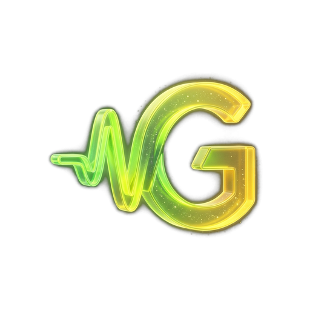

# Glowtune

**Your music, all over your screen.**
Glowtune follows whatever you play, lights your screen edges in the album's colors,
shows synced lyrics, and turns your desktop into a live music scene.

<a href="../../releases/latest">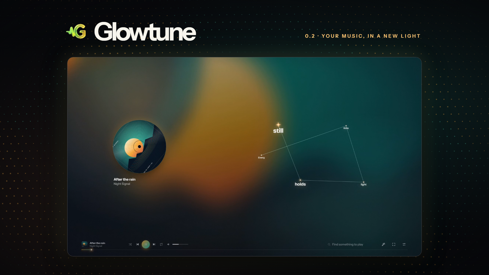</a>

<sub>▶ Watch the 0.2 launch film (75 s): <a href="../../releases/latest">glowtune-0.2-hero.mp4</a> on the latest release.</sub>

[**Download for Windows**](../../releases/latest) · [What's new](#whats-new-in-04) · [Features](#features) · [Privacy](PRIVACY.md) · [Report a bug](#report-a-problem)

</div>

> **Early build.** Glowtune is new and still has bugs. If something breaks, please [tell us](#report-a-problem).

> **🔊 Volume tip.** Turn the volume **all the way up inside Spotify, YouTube Music or SoundCloud**, then set how loud you want it with **Glowtune's** volume (the dock, mini player or Ctrl+Alt+↑/↓). With Automix, Crossfade or the Equalizer on, Glowtune's volume and the service's own slider are separate and don't follow each other, so a low service slider makes everything quieter.

---

## What's new in 0.4

### 🔄 Glowtune updates itself
This is the last version you need to download by hand.
- When a new version is out, a small card appears in the corner of your screen with what's new. Press **Update now**: Glowtune downloads it, installs it and restarts in a few seconds, keeping your settings, themes and sign-ins.
- **Later** and **Skip this version** are there too. It never pops up over a full-screen game, and nothing installs without your click.
- Glowtune checks when it starts and every 6 hours. Check yourself, or turn checking off, in **Settings › About**.
- Every update is signed, and Glowtune refuses anything that isn't signed by us.
- The Microsoft Store version keeps updating through the Store.

## What's new in 0.3

Four new lyric styles, new wallpapers, a see-through player, a refreshed Store, and the fixes you asked for.

### 🔠 Four new lyric styles
- **Shards:** every letter flies in as broken slivers and snaps together just as it's sung. The finished line shrinks away, leaving ghost copies.
- **Tags:** the line hangs on swinging white tags, and each letter rolls like a counter onto its word. At the end, the letters peel off.
- **Code:** the line waits as a row of glowing dots, one per letter, and each dot turns into its letter as it's sung. Corner brackets close in at the end.
- **Melt:** letters are brushed in with a streak of colour. At the end, they run down the screen like wet paint.

Shards, Code and Melt show the next line waiting underneath, and they also work as floating desktop lyrics.

### 🌊 Wallpapers
- **Dots** is new: a field of glowing dots in the song's colours. Every kick drum sends a wave rolling out from a random spot, and the surface goes calm in the quiet parts.
- **Silk** is now sheer and takes the song's colours, so the album cover shows through.
- **Mosaic** and **Silk** are now in the wallpaper menu.

### 🪟 Clear player
A new mini player look with no window at all: the cover, the song and the controls float right on your desktop.

### 🎁 A refreshed Store
29 themes and scene looks, 15 of them new, using the 0.2 glow shapes, particles, wallpapers and lyric styles. **Surprise me** puts on a random look, and **Reinstall** brings an installed theme up to date.

### 🛠️ Fixes and small things
- **Up next** shows the player's queue again.
- After a song change, the progress bar no longer stays full and the lyrics no longer freeze.
- You can **drag the seek bar** on the desktop scene.
- Your own theme stays selected after a restart.
- Turning off **Use the theme's colors** keeps the theme's glow, fonts and lyrics, and only lets the colours follow the album art.
- Lyric size now works for every floating-lyrics look.
- Drag a corner to **resize the floating lyrics box**.
- The album **Glow** look no longer washes out the song's name.

## What's new in 0.2

A whole week of new looks and new ways to play. Here's everything in that update.

### ✨ Stars lyrics
Every word becomes a star, and a thread of light draws to it as it's sung, until the line forms its own little constellation. It sits alongside eight other styles, including the new Depth, Rain and Orbit, and words like *money* or *heart* burst into emoji.

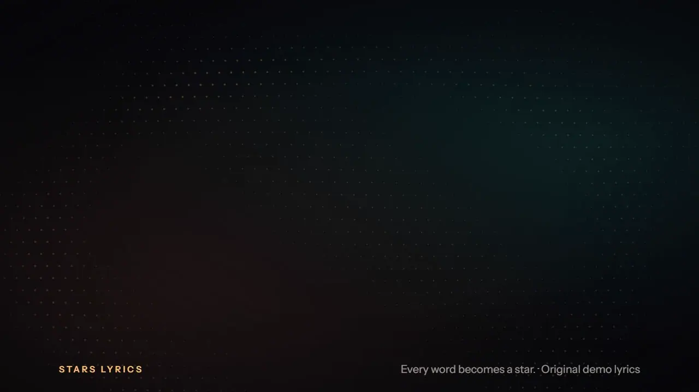

### 🎚️ Scene presets
Set the scene up exactly how you like it (wallpaper, lyrics, album, dock, glow, even where every block sits), give it a name and save it. Bring it back with one click, or with **Ctrl+Alt+1–9** from anywhere.


### ⌨️ Hotkeys that work everywhere
Control the music from any app, even mid-game. A small toast shows what each key did.

| Ctrl+Alt + | | Ctrl+Alt + | |
|---|---|---|---|
| **Space** | Play / pause | **L** | Desktop lyrics on / off |
| **← / →** | Previous / next | **P** | Mini player |
| **↑ / ↓** | Volume | **D** | Desktop scene on / off |
| **S** | Sleep timer | **C** | Lyric card |
| **1–9** | Your presets | **N** | Next preset |

On keyboards where Ctrl+Alt types characters (AltGr), those keys stay free for typing.

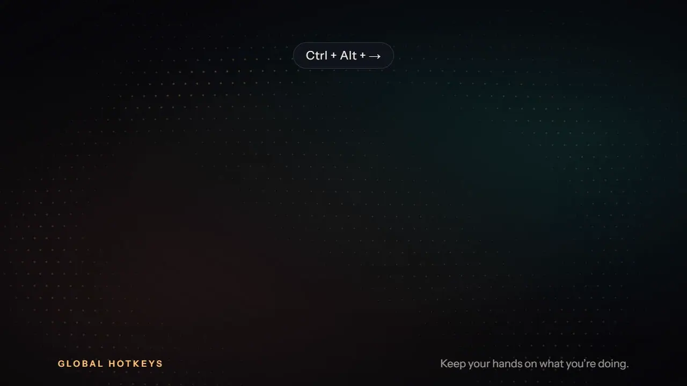

### 🌊 Wallpapers that move with the beat
**Water** runs over the cover, and you can wipe it clear with your mouse. **Frost** fogs it like a cold window. **Halftone** turns it into moving print dots. All three pulse with the kick drum. There's also a slowly moving **Album art** and a calm **Cover**.

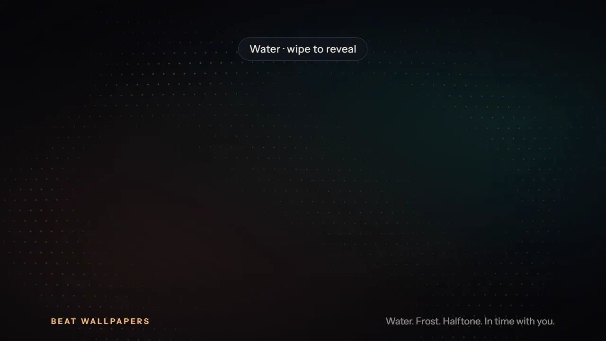

### 💿 Vinyl, and new docks
The album can now spin as a record (the cover *is* the vinyl), or show as Tilt, Print or Glow. The dock comes as Bar, Pill, Islands or Line.


### 🖼️ Lyric cards
Love a line? Press **Ctrl+Alt+C**. Glowtune saves it as a picture with the cover and the album's colors, sized for sharing, in *Pictures › Glowtune*.


### 📊 Your listening stats
Your own small "Wrapped": time listened, top songs and artists, when you listen most, by week, month, year or all time. It never leaves your PC.

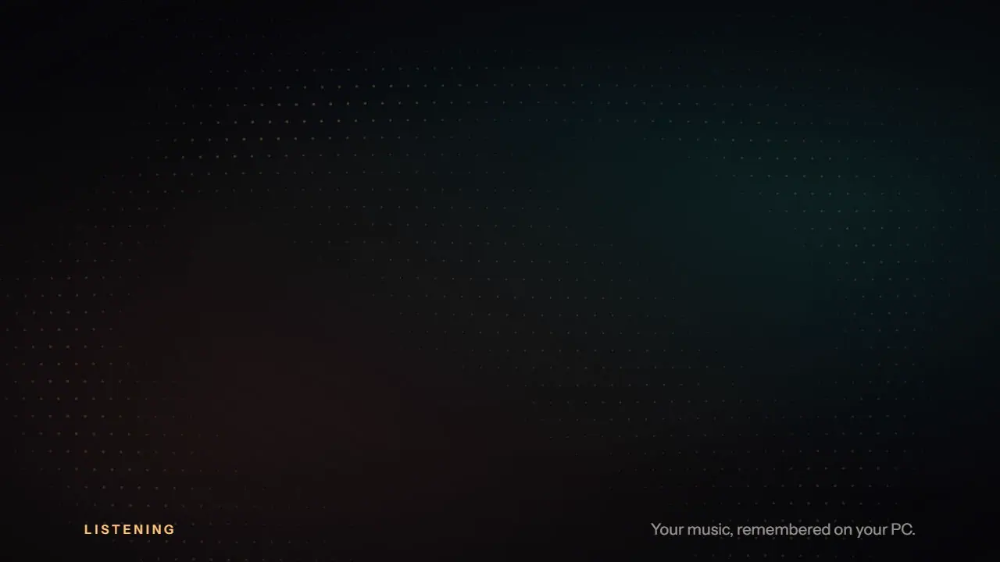

### 🎛️ Mini player, five ways
Glass, Disc, Card, Pill or Lyric, in three sizes, with a volume control. Or put a slim **taskbar player** at either end of your taskbar.


### 🌈 More glow
Five new shapes for the light around your screens (Comets, Aurora, Equalizer, Neon, Tide) and four new particles (Embers, Snow, Fireflies, Bubbles), right from the scene menu.

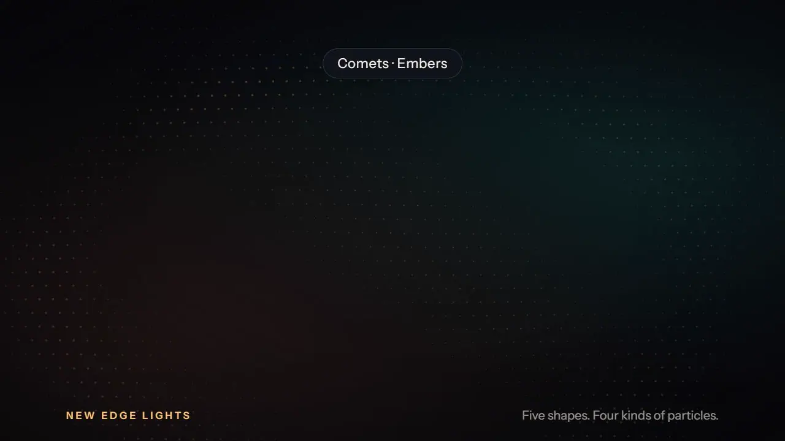

### And also
- **😴 Sleep timer:** pause after 15, 30, 45 or 60 minutes, or when the song ends (scene menu, tray or Ctrl+Alt+S).
- **🎮 Lyrics over games:** floating lyrics can stay up over borderless full-screen games, in the Theme, Stars or Rain look.
- **🔍 Sharper covers:** a big, high-resolution copy of the album cover for the scene.
- **🛠️ Smoother Automix:** song changes no longer freeze the scene, and the glow always stays on top.

Full notes and known issues are on the [release page](../../releases/latest).

---

## Features

### Edge glow
Your screen edges light up in the colors of the album that's playing and pulse with the beat. The glow switches off by itself when a game or video goes full screen; you can choose to keep it on. Pick which screens glow.


### Desktop scene
A live wallpaper behind your windows: a big clock, the album art, synced lyrics, recently played songs and what's up next, over the album's colors, the cover itself, Water, Frost, Halftone, or the song's music video. Save the looks you like as presets. Press **F11** for full screen, **Esc** to leave. Turn on **All screens** to fill every monitor.

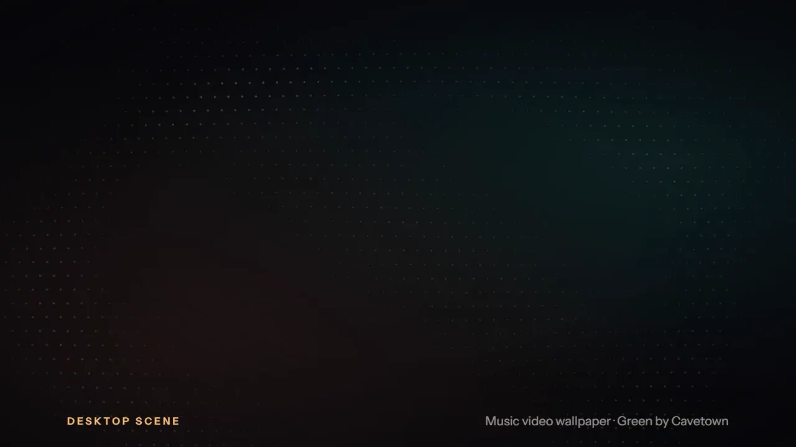


### Synced lyrics
Lyrics scroll in time with the song, word by word. Choose from nine styles, including Stars (each word a star, joined as it's sung), Depth, Rain and Orbit. The **Lyrics view** gives them the whole screen: put them on the left, in the middle or on the right, and make them compact, normal or large. Lyrics also float on your desktop in their own small window.

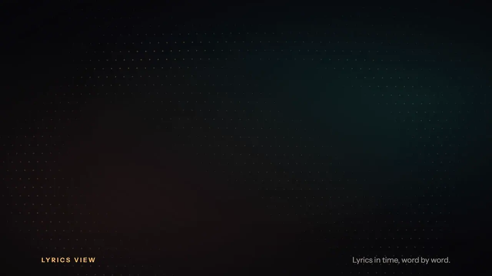

### Make the layout yours
Open **Edit layout** and drag any block where you want it. Pull an edge or corner to resize it: wide, tall or small, the clock, art, lyrics and lists adapt to the space they get. The Lyrics view keeps its own layout.


### Your music services, inside Glowtune
Spotify, Apple Music, YouTube Music and SoundCloud play in their own Glowtune windows. Sign in once and you stay signed in. Ads are blocked in these windows.

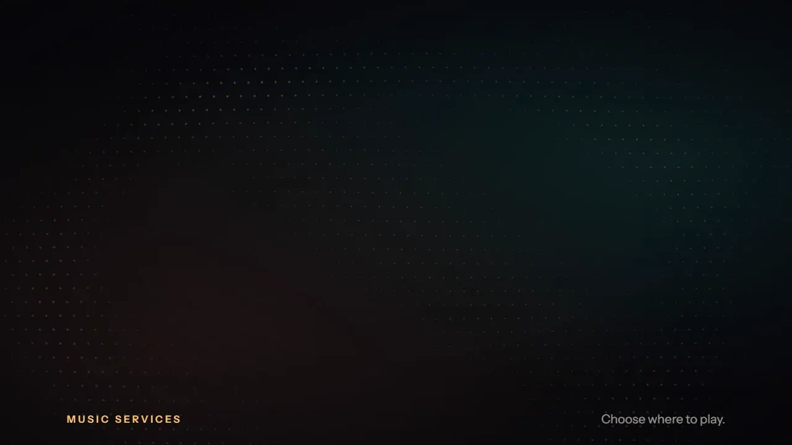

### Search and play
Search from the dock. Click a song and it plays in the service you choose. Press **Enter** to search the service directly.

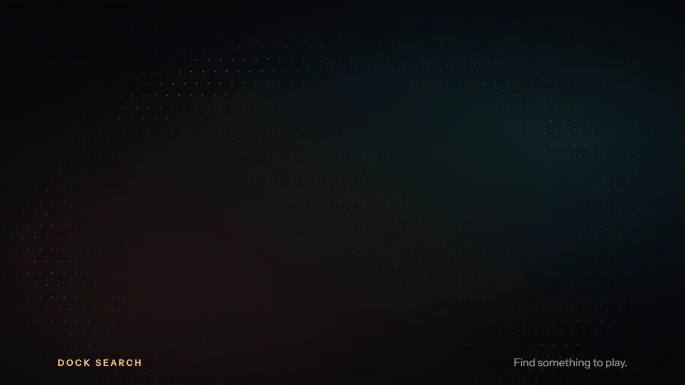

### Up next
See the next songs from the player's own queue, with their covers, and click one to play it. On SoundCloud with autoplay on, Glowtune shows the songs autoplay picks from.

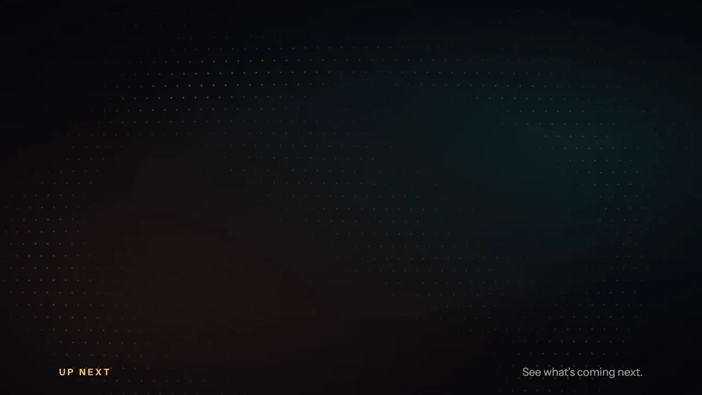

### Controls everywhere
- **Hotkeys from any app:** Ctrl+Alt+**Space** play / pause, **←/→** previous / next, **↑/↓** volume, **L** lyrics, **P** mini player, **D** scene, **S** sleep timer, **C** lyric card, **1–9** presets. Full list in Settings → Hotkeys.
- **F7**: previous. **F8** or **Space**: play / pause. **F9**: next, while the scene is in front. (On many laptops the F keys need the **Fn** key.)
- Hover Glowtune on the taskbar for previous, play / pause and next buttons.
- Volume, shuffle, repeat and like from the dock.
- Works with music playing anywhere on your PC, not only inside Glowtune (the desktop Spotify app, a browser tab and more).

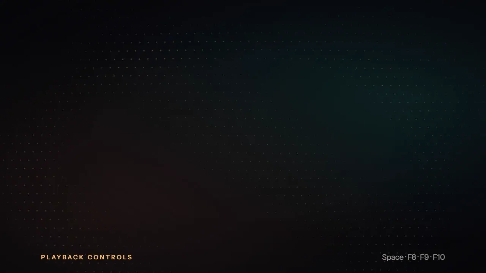

### Themes
Switch the whole look in one click, or make your own theme as a small text file. Bundled: Aurora, Ember and Midnight Glass. More in the built-in Store.

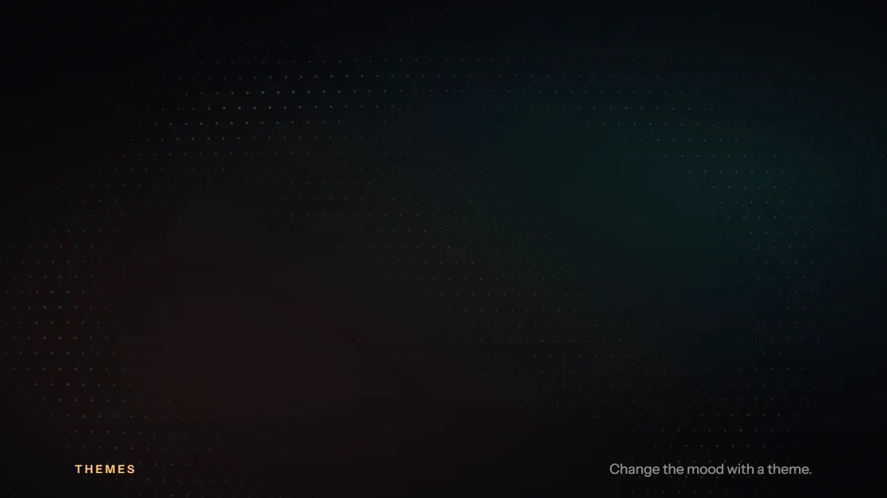

---

## Install

1. Download **`Glowtune_x.y.z_x64-setup.exe`** from the [latest release](../../releases/latest).
2. Run it. It installs for your user only, so it doesn't need admin rights.
3. Glowtune opens its player and puts an icon in the system tray. Play some music, in Glowtune or any app.

**Uninstall:** Windows Settings → Apps → Installed apps → Glowtune → Uninstall.

**Requirements:** Windows 10 or 11 (64-bit). The installer fetches Microsoft's WebView2 runtime if your PC doesn't have it (Windows 11 already does).

### "Windows protected your PC"?
Windows shows this for new downloads that haven't built up a reputation with Microsoft yet. It isn't a virus warning. To be sure the file is the one we published, compare its fingerprint with the `SHA256SUMS.txt` on the release page:

```powershell
Get-FileHash .\Glowtune_0.4.0_x64-setup.exe
```

If they match, click **More info → Run anyway**. Never turn off Microsoft Defender for any app.

---

## Using Glowtune

| To… | Do this |
|---|---|
| Sign in to a service | Tray icon → pick Spotify, Apple Music, YouTube Music or SoundCloud → sign in on its own page. Your login is saved on your PC. |
| Open the desktop scene | Tray menu → Desktop scene. **F11** full screen, **Esc** to leave. |
| Move or resize blocks | Scene menu → **Edit layout**. Drag a block; drag its edge or corner to resize. |
| Change the lyrics view | Lyrics view toolbar → left / middle / right, Compact / Normal / Large. |
| Keep the glow on in full-screen games | Scene menu → Light → turn off "Turn off during full-screen games and videos". |
| Change the look | Settings → Themes, or the Store. |

## Light on your PC

Glowtune is built to sit in the background all day without you noticing it.

Measured on Windows 11 (12-core processor) with music playing and the edge glow on, as Task Manager shows it:

| | CPU | RAM |
|---|---|---|
| **Glowtune** (the "Glowtune" row in Task Manager) | **about 1–2 %** | **about 130 MB** |

- **Nothing runs when nothing plays.** No polling and no background work: audio listening and the beat stop as soon as the music pauses.
- Glowtune draws its windows with Microsoft Edge WebView2, like many Windows apps. Windows lists those helpers separately, as "Microsoft Edge WebView2", and they use more while a window is busy: the desktop scene playing a music video, or a music service window (about as much as that service in a browser tab). Turn off the scene's video background or close a service window when you don't need it.

## Privacy

Everything stays on your PC. No account, no analytics, no tracking, and no Glowtune server. The only things that go online are the music services you open, the lyrics lookup, catalog search and the ad-block filter lists. Each one is listed in **[PRIVACY.md](PRIVACY.md)**.

## Services: good to know

- **Apple Music and SoundCloud** are barely tested. If something doesn't work, please [report it](#report-a-problem) with a screenshot.
- **Google sign-in** is sometimes refused inside apps. Sign in with email instead.
- **SoundCloud autoplay** picks its next song only when the current one ends, so Up next shows what autoplay picks from, not a fixed order.
- Music services change their websites now and then. If a button or list stops working, a report with a screenshot helps fix it fast.

### Known issue: the service's volume slider and Glowtune's volume aren't linked

With Automix, Crossfade or the Equalizer on, the volume slider on the Spotify, YouTube Music or SoundCloud page and Glowtune's own volume are separate. Moving one doesn't move the other. Keep the service at full volume and use Glowtune's volume (see the tip at the top). With all three off, they work together as usual.

**Want them linked?** It's open for anyone who wants it. Pull requests are welcome, and we'll test it together and credit you.

### Known issue: music videos with a long intro

Synced lyrics are timed to the song's **album version**. Some music videos (on YouTube Music, for example) open with a scene, talking or a skit before the song starts. Glowtune can't tell yet, so the lyrics start too early and run ahead of the singing for the whole video. The album version of the same song is in sync.

**Want to fix it?** This one is open for anyone. Glowtune would need to notice where the singing really starts (for example, by comparing the video's length with the album version, or by listening for the first vocals) and shift the lyrics to match. If you can make it work, please open a pull request. We'll test it together and gladly credit you as a co-author. 🙌

## Build from source

You need [Rust](https://rustup.rs) (stable), [Node.js](https://nodejs.org) 20+, [pnpm](https://pnpm.io), and on Windows the Visual Studio C++ build tools.

```sh
git clone <this repo>
cd glowtune/app
pnpm install
pnpm tauri dev        # run with hot reload
pnpm tauri build      # build the installer → target/release/bundle/nsis/
```

Run all checks (format, lint, tests, front-end build) before sending changes:

```sh
./scripts/check.sh
```

How the code is organized: [docs/architecture.md](docs/architecture.md). How to help: [CONTRIBUTING.md](CONTRIBUTING.md).

## Report a problem

This is an early build, so bugs are expected. Your reports help a lot.

- [Open an issue on GitHub](../../issues/new/choose), or
- email **[Preet.saini.0@outlook.com](mailto:Preet.saini.0@outlook.com)**.

Tell us what you did, what happened, and what you were playing. A screenshot helps. Glowtune also has these buttons in Settings → About. Security problems: see [SECURITY.md](SECURITY.md).

## Inspired by, with thanks

Glowtune stands on the shoulders of people who made music on a screen feel alive. These projects showed us what's possible. Glowtune's code, designs and artwork are its own, but the sparks came from here:

- **[iBaila](https://aestheticmac.com/ibaila)**: the idea of an edge light in the album's colors that moves with the beat, and a living desktop for your music.
- **[Needle](https://needlemac.com/)**: its constellation-style lyrics inspired our **Stars** lyric style.
- **[Spicy Lyrics](https://github.com/Spikerko/spicy-lyrics)**: the beautiful word-by-word lyrics and the slowly moving album-art background.
- **[Lyricscape](https://github.com/NIKSHITH-G/lyricscape)**: a playground of lyric styles that pushed us to try Rain, Orbit and Depth.
- **[musikariV2](https://github.com/Hoshi-hikarin2208/musikariV2)**: dreamy backgrounds and particles that inspired our glow particles.
- **[lyrcing](https://github.com/yuvraj0011/lyrcing)**: the fun of emoji bursting out of the lyrics.
- **[JIZURA](https://github.com/852wa/JIZURA)**: its lyric-video motion inspired our **Shards**, **Code**, **Melt** and **Tags** styles.
- **Spotify's full-screen lyrics view**, which set the bar for how lyrics should feel.

And the open-source work Glowtune is built on: [Tauri](https://tauri.app), [Svelte](https://svelte.dev), [wgpu](https://wgpu.rs), [LRCLIB](https://lrclib.net) for lyrics, the [iTunes Search API](https://performance-partners.apple.com/search-api) for artwork, Brave's [adblock-rust](https://github.com/brave/adblock-rust), [Signalsmith Stretch](https://github.com/Signalsmith-Audio/signalsmith-stretch) for smooth tempo changes in Automix, and [Remotion](https://www.remotion.dev) for the videos.

**Thank you** to everyone behind these projects for sharing their work and ideas with the world. And thank you for trying Glowtune. It's made with love for music, and every bug report and idea makes it better. 💜

## Credits

- Lyrics from [LRCLIB](https://lrclib.net).
- Ad blocking by Brave's [adblock-rust](https://github.com/brave/adblock-rust) engine with the [EasyList](https://easylist.to) and [uBlock Origin](https://github.com/uBlockOrigin/uAssets) filter lists (under their own licenses).
- Built with [Tauri](https://tauri.app), [Svelte](https://svelte.dev) and [wgpu](https://wgpu.rs).
- Demo video and clips: "Green" written and performed by Robin Skinner (Cavetown), piano by Rachel Lyon; official music video by Guy Larsen and Taha Khan, a Penny4 production. Excerpts were trimmed, reframed and edited. [Source](https://commons.wikimedia.org/wiki/File:Cavetown_-_Green.webm), [CC BY 3.0](https://creativecommons.org/licenses/by/3.0/). The video was made with [Remotion](https://www.remotion.dev); its source is in [`video/`](video/).

## License

[MIT](LICENSE).

Glowtune is an independent project. It is not affiliated with or endorsed by Spotify, Apple, Google / YouTube or SoundCloud. You need your own account for each service and must follow its terms.
